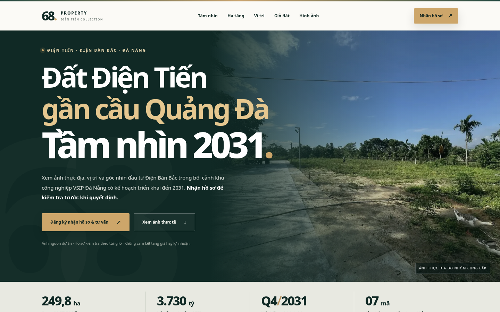

# Đất Điện Tiến, Điện Bàn Bắc, Đà Nẵng – Gần cầu Quảng Đà | 68 Property

**Tìm hiểu vị trí đất Điện Tiến tại phường Điện Bàn Bắc, TP. Đà Nẵng:** xem hình ảnh thực địa, đường tiếp cận, sơ đồ tham khảo, góc nhìn hạ tầng đến năm 2031 và đăng ký nhận hồ sơ để được tư vấn đầu tư bất động sản. Nội dung do **68 Property** giới thiệu, với ưu tiên minh bạch dữ kiện và kiểm tra thông tin trước giao dịch.

**Website dự kiến sau khi bật GitHub Pages:** [Điện Tiến – 68 Property](https://phinguyenreal-danang.github.io/dientien7lo/)  
**Kho mã nguồn:** [github.com/phinguyenreal-danang/dientien7lo](https://github.com/phinguyenreal-danang/dientien7lo)

> **Lưu ý:** Liên kết website chỉ hoạt động sau khi GitHub Pages được triển khai thành công. Thông tin trong tài liệu không thay thế hồ sơ pháp lý, tư vấn đầu tư cá nhân hay xác nhận tình trạng còn bán.



## Tổng quan dự án đất Điện Tiến

Khu đất được giới thiệu nằm tại **Điện Tiến, phường Điện Bàn Bắc, thành phố Đà Nẵng**. Tài liệu khảo sát cung cấp cho dự án mô tả vị trí **cách cầu Quảng Đà khoảng 200 m**. Đây là khoảng cách tham khảo, cần đo và đối chiếu với đúng thửa đất, tuyến đường tiếp cận và hồ sơ địa chính.

Bộ tư liệu hiện có gồm ảnh đất trống, hình ảnh đường bê tông tiếp cận và sơ đồ định vị. Trang giới thiệu tập trung giúp người quan tâm chủ động tìm hiểu thông tin trước khi đặt lịch xem đất:

- **Vị trí & kết nối:** tra cứu khu vực Điện Tiến – Điện Bàn Bắc, cầu Quảng Đà và các tuyến đường thực tế.
- **Ảnh thực địa:** tham khảo nhiều góc nhìn của khu đất, không thay ảnh hiện trạng bằng phối cảnh quảng cáo.
- **Danh sách sản phẩm:** 7 mã lô tham khảo từ bảng hàng nội bộ; diện tích, giá, pháp lý và trạng thái giao dịch cần xác nhận theo từng mã.
- **Tư vấn:** đăng ký họ tên, số điện thoại và nhu cầu để nhận thông tin được phép chia sẻ và hẹn khảo sát thực tế.

### Tầm nhìn hạ tầng và khu công nghiệp VSIP Đà Nẵng đến năm 2031

Theo thông tin công bố về **khu công nghiệp VSIP Đà Nẵng**, dự án có quy mô khoảng **249,8 ha**, tổng vốn đầu tư công bố khoảng **3.730 tỷ đồng**, với lộ trình triển khai và đưa vào khai thác **dự kiến đến quý IV/2031**. Đây là dữ kiện hạ tầng đáng theo dõi trong quá trình nghiên cứu Điện Bàn Bắc.

Nếu khu công nghiệp hoàn thành, thu hút doanh nghiệp và tạo thêm việc làm đúng tiến độ, khu vực có thể phát sinh thêm nhu cầu **nhà ở, thuê trọ, lưu trú, ăn uống, bán lẻ và dịch vụ thiết yếu**. Tuy nhiên, **số lượng công nhân tương lai, nhu cầu thuê thực tế, giá bất động sản và khả năng sinh lời hiện chưa thể xác nhận**. Khu đất giới thiệu không được mặc nhiên xem là nằm trong khu công nghiệp hoặc được bảo đảm hưởng lợi.

Kết nối giao thông qua cầu Quảng Đà cũng cần đánh giá theo **trạng thái đường dẫn và các tuyến tiếp cận tại thời điểm khảo sát**, thay vì coi toàn bộ hạ tầng đã hoàn thiện.

**Người mua nên kiểm tra:** giá theo ngày cập nhật, loại đất, diện tích được công nhận, quy hoạch sử dụng đất, đường tiếp cận, khả năng xây dựng/khai thác và các khoản chi phí trước khi ra quyết định.

### Vì sao nên xem hồ sơ và khảo sát thực tế?

Thông tin hình ảnh và bản đồ giúp sàng lọc bất động sản từ xa, nhưng quyết định đầu tư cần căn cứ vào **hồ sơ thửa đất và tình trạng thực tế**. 68 Property hướng tới quá trình tư vấn có đối chiếu, không sử dụng thông điệp “chắc chắn tăng giá”, “cam kết lợi nhuận” hoặc “sắp hết hàng” nếu không có bằng chứng cập nhật.

**Xem thông tin và đăng ký nhận hồ sơ:** [Mở trang giới thiệu đất Điện Tiến](https://phinguyenreal-danang.github.io/dientien7lo/).

## Câu hỏi thường gặp

**Đất Điện Tiến nằm ở đâu?**  
Khu đất được giới thiệu thuộc Điện Tiến, phường Điện Bàn Bắc, TP. Đà Nẵng. Vị trí chính xác của từng lô cần kiểm tra trên hồ sơ và bản đồ được xác nhận.

**Khu đất cách cầu Quảng Đà bao xa?**  
Tài liệu khảo sát ghi khoảng 200 m; số liệu chưa thay thế phép đo tuyến đường và vị trí thực tế.

**VSIP Đà Nẵng đã đi vào hoạt động chưa?**  
Theo hồ sơ nguồn năm 2026, mốc đến quý IV/2031 là **dự kiến theo tiến độ**, không phải xác nhận khu công nghiệp đã vận hành hoặc có số lượng lao động cụ thể.

**Có thể xem diện tích, giá và pháp lý của 7 lô ở đâu?**  
Bảng hàng nội bộ có các mã tham khảo, nhưng thông tin chính thức cần đội ngũ phụ trách xác nhận theo thời điểm hỏi và giấy tờ từng thửa trước khi công khai.

**Làm sao nhận hồ sơ tư vấn?**  
Truy cập landing page, điền thông tin vào form và chấp thuận việc liên hệ tư vấn. Form chỉ hoạt động sau khi API Cloudflare Worker và Telegram được cấu hình đúng và kiểm thử thực tế.

---

## Thông tin kỹ thuật website

Website được xây dựng bằng **HTML, CSS, JavaScript**, xuất bản tĩnh trên **GitHub Pages**, tối ưu đọc trên điện thoại. Form nhận nhu cầu tư vấn sử dụng **Cloudflare Worker** làm backend riêng để gửi thông báo đến nhóm Telegram. **Không đặt Telegram Bot Token trong HTML, JS hoặc repository công khai.**

### Cấu trúc mã nguồn

```text
.github/workflows/deploy.yml  # GitHub Actions xuất bản Pages
site/index.html               # Landing page công khai
site/assets/                 # Hình ảnh WebP, CSS, JS
site/config.js               # Cấu hình công khai: Worker URL, Turnstile site key
site/robots.txt              # Chính sách crawler, liên kết sitemap
site/sitemap.xml             # Sitemap nguồn, tự thay URL khi build
site/chinh-sach-bao-mat.html  # Chính sách dữ liệu cá nhân
scripts/build.mjs            # Tạo thư mục dist và URL SEO theo tên miền
worker/worker.js             # API form và Telegram (secrets ở Cloudflare)
tests/                       # Bài kiểm thử
```

### Cách xuất bản lên GitHub Pages

1. Đưa **nội dung các thư mục ở gốc repository** lên nhánh `main`, bao gồm thư mục `.github` ẩn. Không upload nguyên file ZIP để chạy trực tiếp.
2. Trong repository, mở **Settings → Pages → Build and deployment → Source: GitHub Actions**.
3. Vào tab **Actions**, chờ workflow `Deploy GitHub Pages SEO landing` hoàn tất.
4. Kiểm tra URL chính thức: <https://phinguyenreal-danang.github.io/dientien7lo/>.
5. Nếu dùng tên miền riêng, đặt biến repository `SITE_URL` với URL HTTPS đầy đủ (có dấu `/` cuối), sau đó chạy lại workflow để cập nhật canonical, OpenGraph, sitemap và robots.
6. Cấu hình riêng Cloudflare Worker, Telegram và Turnstile theo hướng dẫn trong mã nguồn; thử gửi form thật trước khi chạy quảng cáo.

### SEO cho Google và Bing: những việc cần làm sau khi website hoạt động

**README giới thiệu repository không tự khiến landing page được Google/Bing lập chỉ mục.** Công cụ tìm kiếm cần truy cập được URL website công khai. Dự án đã chuẩn bị tiêu đề, mô tả, nội dung tiếng Việt, HTML có H1/H2, ảnh có alt, dữ liệu có cấu trúc, canonical, OpenGraph và `sitemap.xml`. Tệp `robots.txt` có trong gói, nhưng trên GitHub Pages dạng `/dientien7lo/` nó nằm ở **đường dẫn con**, không phải `/robots.txt` tại gốc hostname: theo quy tắc Google, tệp ở đường dẫn con **không điều khiển crawler**; muốn quản lý robots.txt đầy đủ nên dùng tên miền riêng và đặt tại gốc domain.

- **Google Search Console:** tạo thuộc tính *URL-prefix* theo URL website; xác minh sở hữu, gửi `https://phinguyenreal-danang.github.io/dientien7lo/sitemap.xml`; dùng **URL Inspection → Request indexing** với trang chủ sau khi xác minh.
- **Bing Webmaster Tools:** thêm và xác minh website hoặc nhập thuộc tính từ Search Console; gửi cùng sitemap; dùng **URL Inspection** để kiểm tra trang và **URL Submission** nếu cần. IndexNow là tùy chọn phù hợp hơn khi có quyền quản lý tên miền và vị trí đặt tệp xác minh.
- **Kiểm tra kỹ thuật:** mở `sitemap.xml`, xem View Source để bảo đảm canonical/og:url/og:image là URL thật (không còn `example.invalid`); trang trả về HTTP 200, có thể truy cập trên thiết bị không đăng nhập. Với GitHub Pages dạng thư mục con, không coi `.../dientien7lo/robots.txt` là robots.txt tại gốc host.
- **Nội dung:** cập nhật khi pháp lý, giá, ảnh và tiến độ hạ tầng thay đổi; tạo liên kết tự nhiên từ website và các trang BĐS/Facebook công khai. Không nhồi nhét từ khóa hoặc đăng các bản sao y hệt ở nhiều URL.
- **Theo dõi:** xem báo cáo Indexing và Performance; việc gửi sitemap/yêu cầu lập chỉ mục không bảo đảm sẽ xuất hiện hoặc đạt vị trí cao ngay.

Hướng dẫn thao tác từng bước: [SEO_GOOGLE_BING.md](SEO_GOOGLE_BING.md).

### Từ khóa nội dung tham khảo

`đất Điện Tiến` · `đất Điện Bàn Bắc` · `đất gần cầu Quảng Đà` · `bất động sản Đà Nẵng` · `xem đất Điện Tiến` · `VSIP Đà Nẵng 2031`.

Các cụm từ này dùng để biên tập nội dung có ích, **không phải thẻ meta keywords để nhồi từ khóa**.

### Nguồn tham khảo và kiểm chứng

- [Thông tin công bố về KCN VSIP Đà Nẵng – Cổng thông tin Đà Nẵng](https://cttdt.danangportal.gov.vn/en/web/dng/w/chap-thuan-chu-truong-dau-tu-du-an-khu-cong-nghiep-vsip-da-nang-quy-mo-gan-250-ha)
- [Thông tin cầu Quảng Đà và đường dẫn – Tiền Phong](https://svvn.tienphong.vn/da-nang-cau-da-xong-sao-nguoi-dan-chat-vat-di-vong-post1886253.tpo)
- Ảnh thực địa, file vị trí và bảng hàng nội bộ do nhóm dự án cung cấp; **chưa thay thế tài liệu pháp lý được kiểm chứng**.
- [Google Search Central – SEO Starter Guide](https://developers.google.com/search/docs/fundamentals/seo-starter-guide)
- [Bing Webmaster Tools – Sitemaps](https://www.bing.com/webmasters/help/sitemaps-3b5cf6ed)

### Bảo mật, dữ liệu cá nhân và tình trạng nghiệm thu

- Bổ sung đơn vị quản lý dữ liệu và thông tin liên hệ thật trong trang chính sách bảo mật **trước khi công khai**.
- Các biến `TELEGRAM_BOT_TOKEN`, `TELEGRAM_CHAT_ID`, `TURNSTILE_SECRET_KEY`, `HASH_PEPPER` phải ở **Cloudflare Secrets**, không commit vào GitHub.
- Kiểm tra quyền sử dụng ảnh, bảng hàng, loại đất và hồ sơ từng lô trước khi quảng bá.
- Test offline không thay thế kiểm thử gửi Telegram thật, kiểm tra lập chỉ mục hoặc đo hiệu suất thực tế trên tên miền đã triển khai.

**Đơn vị giới thiệu:** 68 Property · **Chủ đề:** Đất Điện Tiến – Điện Bàn Bắc – cầu Quảng Đà, Đà Nẵng.
